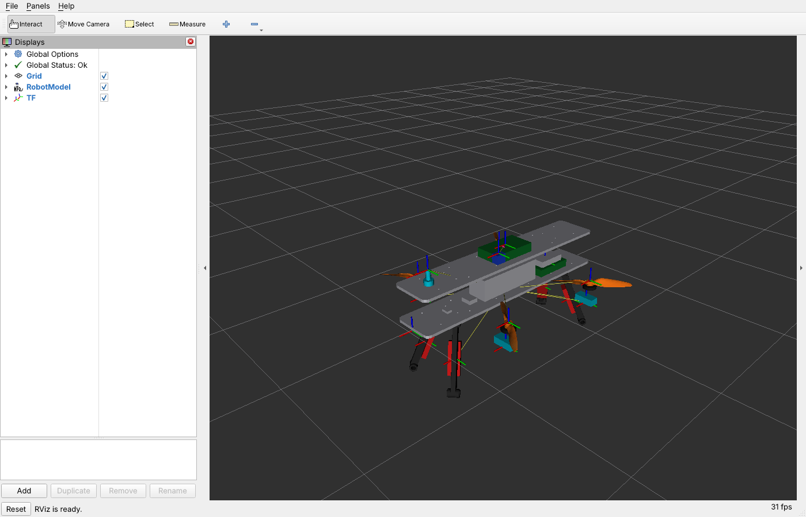
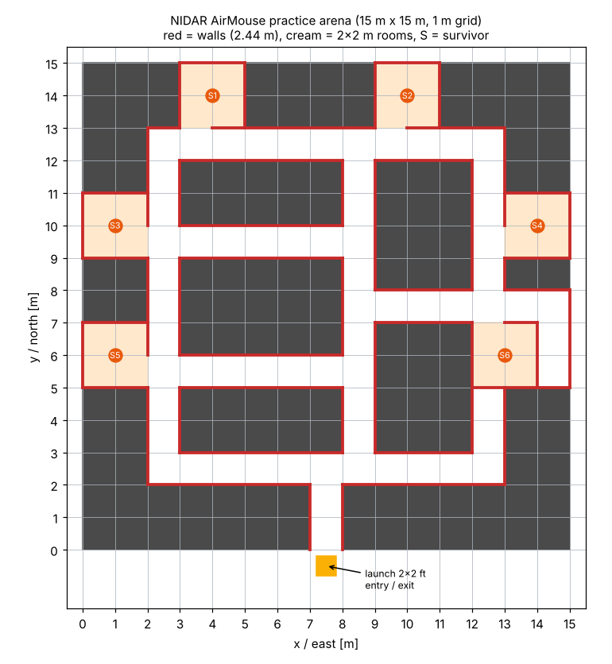
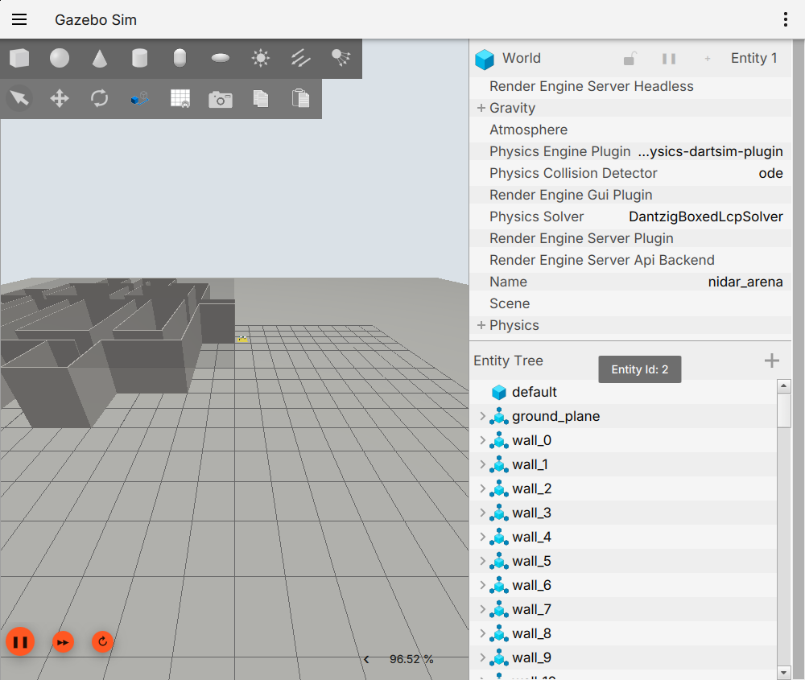
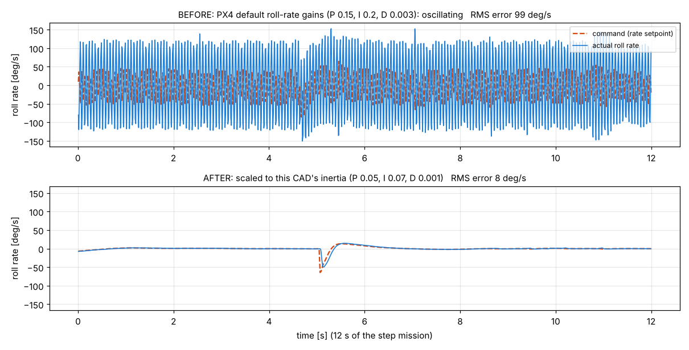

# 0. Read this first

This guide assumes you know **nothing** and have **nothing installed**. Follow it top to bottom and
copy-paste every command exactly. Every step ends with a **✅ You should see** box: if you
see that, move on; if not, go to **Section 11 (Troubleshooting)**.

**What you will have at the end**

| Deadline task | What you will run | Section |
|---|---|---|
| Drone model in **RViz** | `ros2 launch nidar_drone_description display.launch.py` | 5 |
| Same URDF in **Gazebo**, flying | `ros2 launch nidar_drone_description gazebo.launch.py` | 6 |
| **PX4 setup** with env + URDF | `make px4_sitl gz_nidar_drone` | 7 |
| **PX4 – QGC – ROS 2** link, commands simulated, speed from QGC | 5 terminals, `offboard.launch.py` | 7 |
| **Rulebook fail-safes**: e-stop, abort, recall, comm loss, low battery, geofence | `/nidar/...` topics | 7.6 |
| **PID tuning**: print command vs actual, then the thorough method | `pid_logger`, `step` mission, `pid_analyze.py` | 8 |

**Built to the NIDAR 26-27 Rulebook Ver 2.2 (Problem Statement 2, AirMouse).** The rule-by-rule check
is in [`docs/RULEBOOK_COMPLIANCE.md`](RULEBOOK_COMPLIANCE.md). The rules that shape this guide:

* **No GPS/GNSS navigation (rule 8.24).** PX4 runs with GPS and magnetometer **off** and gets its position
  only from *vision odometry*. In simulation that comes from Gazebo through the `ev_bridge` node; on the
  real drone the SLAM pose goes into the same node.
* **The practice arena follows the rules:** 15 × 15 m, 1 m corridors, 2 × 2 m rooms, 8 ft ceiling with a
  net, one entry/exit, a 2 ft × 2 ft launch area, and 6 survivor dummies.
* **Fail-safes (rule 8.31, PS2 section 10):** emergency stop, mission abort, emergency recall, comm loss,
  low battery, geofence, and the 30-min flight limit. Recall flies **back out of the same entry** and
  lands **in the launch area**.
* **Propeller guards (rule 8.30)** are on the model (placeholders until the CAD has real ones).

**All of this was tested** on Ubuntu 24.04 with ROS 2 Jazzy, Gazebo Harmonic 8 and PX4 v1.16.0, with
**GPS off**:

* The drone spawns on the launch area and all sensors publish.
* It flies under Gazebo's own controller.
* Under PX4 it takes off from the launch area, flies through the entry and up the arena's central
  corridor into a room, comes back out of the entry by recall, and lands in the launch area. All of
  this is commanded from ROS 2.
* Every fail-safe was triggered and checked (Section 7.6).

**Software versions used (do not mix versions):**
Ubuntu **24.04** · ROS 2 **Jazzy** · Gazebo **Harmonic** · PX4 **v1.16.0** · px4_msgs **release/1.16** ·
Micro XRCE-DDS Agent **v2.4.3** · QGroundControl (latest).

**Time needed:** about 2–3 hours, mostly waiting for downloads and compiling (Section 1–4).
Sections 5–8 then take minutes each.

---

# 1. Create the virtual machine

## 1.1 What your computer needs

* Windows/Mac/Linux laptop with **at least 16 GB RAM** (8 GB works, but slowly) and **100 GB free disk**.
* Virtualisation switched on in the BIOS (called *Intel VT-x* or *AMD-V / SVM*). If VirtualBox later
  says "VT-x is disabled", restart the laptop, enter BIOS (F2/F10/Del while booting), enable it.

## 1.2 Download two things

1. **Ubuntu 24.04 LTS Desktop** ISO: <https://ubuntu.com/download/desktop> (file `ubuntu-24.04.x-desktop-amd64.iso`, ~6 GB).
2. A VM program — pick **one**:
   * **VMware Workstation Pro** (free for personal use) — *recommended*, best 3D graphics for Gazebo.
     <https://www.vmware.com/products/desktop-hypervisor/workstation-and-fusion>
   * **VirtualBox** — <https://www.virtualbox.org/wiki/Downloads> (also install the *Extension Pack*).

> **Apple Silicon Mac (M1/M2/M3/M4)?** These steps need an x86 (Intel/AMD) machine. PX4 + Gazebo on
> ARM Macs needs UTM with Ubuntu ARM and is not covered here; use a team member's Windows/Linux laptop.

## 1.3 Make the VM (settings that matter)

| Setting | Value |
|---|---|
| Memory (RAM) | **8 GB minimum, 12 GB+ if you have 16 GB** |
| CPUs | **4 or more** (half your laptop's cores) |
| Disk | **100 GB** (dynamically allocated is fine) |
| Graphics / Display | **Enable 3D acceleration**, video memory **max (128 MB VirtualBox / 8 GB VMware)** |
| VirtualBox graphics controller | **VMSVGA** |
| Network | NAT (default) |

**VMware:** *Create a New Virtual Machine → Typical → Installer disc image file (iso) → choose the
Ubuntu ISO → name `nidar-vm` → disk 100 GB → Customize Hardware* → set memory/CPUs → *Display →
Accelerate 3D graphics ✔*.

**VirtualBox:** *New → Name `nidar-vm`, ISO image = the Ubuntu ISO, ✔ Skip Unattended Installation →
Memory/CPUs as above → Disk 100 GB → Finish*. Then *Settings → Display → Video Memory 128 MB,
Graphics Controller VMSVGA, ✔ Enable 3D Acceleration*.

## 1.4 Install Ubuntu inside the VM

Start the VM → *Try or Install Ubuntu* → **Install Ubuntu** → language English → keyboard →
*Normal installation* → *Erase disk and install Ubuntu* (this only erases the **virtual** disk) →
create a user (e.g. `nidar`, remember the password) → wait ~15 min → *Restart now* (press Enter if it
asks to remove the installation medium).

## 1.5 Guest tools (copy-paste between laptop and VM, proper screen size)

Open a **Terminal** inside Ubuntu (press **Ctrl + Alt + T**) and run:

* **VMware:**
  ```bash
  sudo apt update && sudo apt install -y open-vm-tools-desktop
  sudo reboot
  ```
* **VirtualBox:** menu *Devices → Insert Guest Additions CD image*, then
  ```bash
  sudo apt update && sudo apt install -y build-essential dkms linux-headers-$(uname -r) bzip2
  sudo sh /media/$USER/VBox_GAs_*/VBoxLinuxAdditions.run
  sudo reboot
  ```
  Then *Devices → Shared Clipboard → Bidirectional*.

> ✅ **You should see:** the Ubuntu desktop fills the VM window, and text copied on your laptop can
> be pasted into the VM terminal with **Ctrl + Shift + V**.

---

# 2. Terminal basics (2 minutes)

* Open a terminal: **Ctrl + Alt + T**. Open another tab in it: **Ctrl + Shift + T**.
* **Paste** in a terminal: **Ctrl + Shift + V** (plain Ctrl+V does not work there).
* **Stop** a running program: **Ctrl + C**.
* `sudo` = run as administrator; it asks for **your password**. Nothing appears while you type it — that's normal.
* A line starting with `#` in this guide is a comment; you don't have to type it.
* When this guide says **"new terminal"**, open a *new* one: settings from install scripts only load in new terminals.

---

# 3. Get the NIDAR code

```bash
sudo apt update && sudo apt install -y git
cd ~
git clone -b mr.developer4u/serene-carson-t3dd93 \
  https://github.com/abhyudaysaksena06/nidar-airmouse-obstacle-avoidance.git nidar
cd ~/nidar
ls
```

*If GitHub asks for a username/password:* the repo is private. Either ask the repo owner to add your
GitHub account as a collaborator and use a *personal access token* as the password
(GitHub → Settings → Developer settings → Personal access tokens), or download the ZIP from the GitHub
page (*Code → Download ZIP*, choose the branch above first), and unzip it to `~/nidar`.

> ✅ **You should see:** folders `ros2_ws  px4  setup  tools  docs  cad_export_original ...`

**What is in it**

| Folder | What it is |
|---|---|
| `ros2_ws/src/nidar_drone_description` | The drone: URDF (from your SolidWorks export), meshes, RViz + Gazebo launch files, sensors |
| `ros2_ws/src/nidar_control` | ROS 2 nodes: `offboard_control` (sends commands to PX4), `pid_logger` (command vs actual) |
| `px4/` | PX4 model + airframe of the NIDAR drone, scripts that install them into PX4 |
| `setup/` | One-shot install scripts (Section 4) |
| `tools/` | `cad_urdf_to_xacro.py` (re-import CAD), `pid_analyze.py` (PID report + graphs) |
| `cad_export_original/` | Your original SolidWorks URDF export, untouched, for reference |

---

# 4. Install everything (run 5 scripts)

Run them **in order**, each in a terminal, from `~/nidar`. Each prints a green **OK** at the end.
If one stops with red text, read Section 11, fix, and **run the same script again** (they are safe to re-run).

### 4.1 ROS 2 Jazzy + Gazebo Harmonic (~15–20 min)
```bash
cd ~/nidar
bash setup/01_install_ros2_gazebo.sh
```
Then **close the terminal and open a new one**.

### 4.2 PX4 + the NIDAR drone model (~45–60 min)
```bash
cd ~/nidar
bash setup/02_install_px4.sh
```
This downloads PX4 v1.16.0 to `~/PX4-Autopilot`, installs its tools, copies the NIDAR model/airframe
into it, enables the PID topics, and compiles it.
**Then reboot the VM:** `sudo reboot`.

### 4.3 PX4 ↔ ROS 2 bridge (~10 min)
```bash
cd ~/nidar
bash setup/03_install_agent_px4msgs.sh
```

### 4.4 QGroundControl (~3 min)
```bash
cd ~/nidar
bash setup/04_install_qgc.sh
```
Log out and back in once (top-right menu → *Log Out*), so the `dialout` permission applies.

### 4.5 Build our ROS 2 workspace (~6 min)
```bash
cd ~/nidar
bash setup/05_build_workspace.sh
```
Open a **new terminal**.

### 4.6 Check
```bash
bash ~/nidar/setup/check_setup.sh
```
> ✅ **You should see:** every line `[OK]` and `10 OK, 0 missing`.

---

# 5. TASK 1a — The drone in RViz (deadline: tonight / tomorrow 5 PM)

RViz *shows* the URDF (no physics). This proves the CAD export is correct: links, meshes, joints, sizes.

```bash
ros2 launch nidar_drone_description display.launch.py
```



**What to do / check in RViz**

1. Left panel **RobotModel** → ✔, **TF** → ✔ (coloured arrows = each link's frame: red = x/forward, green = y/left, blue = z/up).
2. Rotate: left-drag. Zoom: scroll. Pan: Shift + drag (or middle-drag).
3. The small window **Joint State Publisher** has 4 sliders `prop_1_joint` … `prop_4_joint`. Move them: each
   propeller must spin around its own motor. (In the original export **prop 4 could not turn** — fixed.)
4. Measure: toolbar **Measure**, click two points (e.g. tips of two motors) → distance appears at the bottom.
   Motor-to-motor: 0.244 m front-to-back, 0.280 m left-to-right, 0.371 m diagonal.

> ✅ **You should see:** grey two-plate frame, black motors, orange props inside light-blue see-through
> **propeller guards** (rule 8.30: placeholders until the CAD has real ones), red ESC blocks, black
> landing gear, green flight controller + Raspberry Pi, cyan sensors. No red errors in the terminal.
> *Global Status: Ok* in RViz.

**Verify the URDF from the command line (good habit after every CAD change):**
```bash
cd ~/nidar/ros2_ws/src/nidar_drone_description
xacro urdf/nidar_drone.urdf.xacro > /tmp/nidar.urdf && check_urdf /tmp/nidar.urdf | head -5
gz sdf -p /tmp/nidar.urdf > /dev/null && echo "Gazebo can read it"
```

Stop RViz with **Ctrl + C** in the terminal.

---

# 6. TASK 1b — Verify the URDF in Gazebo (physics + sensors)

Same URDF, now with gravity, collisions, motor models and sensors.

```bash
ros2 launch nidar_drone_description gazebo.launch.py
```
(First start can take 1–2 minutes while Gazebo prepares its graphics. Very slow VM? add `rviz:=false`.)

Two windows open:

* **Gazebo** shows the **NIDAR practice arena**. The drone sits on the yellow 2 ft × 2 ft launch
  area just outside the entry, facing in.
* **RViz** shows what ROS 2 receives: lidar points in red (they trace the arena walls), ToF in cyan,
  ultrasonics in yellow, and the camera image.

In Gazebo, right-click the drone → **Follow** to keep the camera on it.

The arena is generated by `worlds/make_arena.py` to the rulebook's numbers (PS2 section 3, Annexure 5):

* 15 × 15 m on a 1 m grid (the grid is painted on the floor, as the judges' reference grid);
* 1 m corridors and 2 × 2 m rooms;
* walls and a see-through roof net at 2.44 m (8 ft);
* one entry/exit, and 6 survivor dummies (S1–S6), one in each room.

The real layout is secret until the event, so edit the `LAYOUT` text in the script to practise on
others. The script checks room sizes and that everything can be reached from the entry.





### 6.1 Check every sensor reaches ROS 2 — new terminal
```bash
ros2 topic list
ros2 topic hz /scan          # Ctrl+C after a few lines
```
> ✅ **You should see (measured in testing):**
>
> | Topic | Sensor | Rate |
> |---|---|---|
> | `/scan` | RPLIDAR (2D, 360°, 12 m) | ~10 Hz |
> | `/tof_front/points` | VL53L5CX 8×8 ToF, front | ~15 Hz |
> | `/ultrasonic_1` … `_4` | 4 × ultrasonic, looking down | ~10 Hz |
> | `/camera/image_raw` | camera under frame, looking down | ~15 Hz |
> | `/imu` | IMU on flight controller | ~250 Hz |
> | `/odom`, `/tf` | ground-truth position | ~50 Hz |
> | `/joint_states` | propeller angles | ~250 Hz |

### 6.2 Physical checks

* The drone must **rest on its landing gear**: `ros2 topic echo --once /odom --field pose.pose.position` → `z ≈ 0.143`
  (base 14.3 cm above ground — exactly what the CAD gives).
* Total mass as Gazebo sees it: **1.50 kg** (body 1.394 kg + 4 props + 4 × 20 g prop guards); the
  rulebook limit is 10 kg. *No battery in the CAD* (see Section 10).
* Size with guards: **0.48 m × 0.45 m**. That fits the 0.61 m × 0.61 m launch area and leaves
  0.27 m on each side in a 1 m corridor.

### 6.3 Fly it without PX4 (Gazebo's built-in velocity controller) — new terminal
```bash
# 1. switch the controller on
ros2 topic pub --once /enable std_msgs/msg/Bool "{data: true}"
# 2. climb at 0.5 m/s for ~2 s (to ~1.2 m; the roof net is at 2.44 m), then Ctrl+C
ros2 topic pub -r 10 /cmd_vel geometry_msgs/msg/Twist "{linear: {z: 0.5}}"
# 3. hover (send zero), then forward 0.5 m/s: the drone faces the entry, so it flies
#    into the entry corridor. Ctrl+C after ~4 s, then send zero again.
ros2 topic pub -r 10 /cmd_vel geometry_msgs/msg/Twist "{}"
ros2 topic pub -r 10 /cmd_vel geometry_msgs/msg/Twist "{linear: {x: 0.5}}"
```
Or use the keyboard: `sudo apt install -y ros-jazzy-teleop-twist-keyboard` then
`ros2 run teleop_twist_keyboard teleop_twist_keyboard` (keys `t`/`b` = up/down, `i` = forward, `k` = stop).

> ✅ **You should see:** props spin, the drone climbs, holds height, flies where commanded. Watch the
> lidar points move on the walls in RViz.
>
> **Known and expected:** in this *PX4-free* test the drone creeps backwards ~0.1 m/s in hover.
> Cause: the CAD centre of mass is 11 mm behind the motor centre and Gazebo's simple controller
> has no integral term. PX4 (Section 7) corrects this; it does not happen there.

**Task 1 is done** when Sections 5 and 6 pass. Take screenshots (`PrtSc` key) for the team.

---

# 7. TASK 2 + 3 — PX4 + QGroundControl + ROS 2 (deadline: Tuesday night)

## 7.1 How the pieces connect

```
 offboard_control (mission + fail-safes)   ev_bridge (position: NO GPS)     QGroundControl
   │ /fmu/in/trajectory_setpoint             │ /fmu/in/vehicle_visual_odometry │ MAVLink UDP 14550
   │ /fmu/in/vehicle_command                 │  ▲ /odom (sim: Gazebo pose,     │ params, status
   ▼                                         ▼  │       real: SLAM pose)      ▼
 MicroXRCEAgent (UDP 8888) ◄──── uXRCE-DDS ────►  PX4 SITL (autopilot, GPS+mag OFF)
                                                        │ motor speeds / IMU, baro
                                                        ▼
                                           Gazebo (NIDAR drone in the practice arena)
```
* **PX4 SITL** = the real PX4 flight software, running on the VM instead of on the flight controller.
* **Gazebo** = physics: PX4 sends motor speeds, Gazebo sends back IMU and barometer. **There is no GPS**
  (rule 8.24).
* **ev_bridge** = gives PX4 its position. It is *vision odometry*, the same interface the real drone's
  SLAM will use. Without it PX4 has no position and won't take off in Offboard.
* **QGroundControl** = the ground station: map, arm/disarm, flight modes, **parameters** (speed limits, PID gains).
* **MicroXRCEAgent** = the bridge that makes PX4's internal topics appear as ROS 2 topics `/fmu/...`.
* **Everything is local** (rule 8.4): localhost/UDP on the VM, with no internet or cloud. Internet is only
  needed once, to install the software.

## 7.2 Start everything — 5 terminals, in this order

**Terminal 1 — PX4 + Gazebo with the NIDAR drone**
```bash
cd ~/PX4-Autopilot
make px4_sitl gz_nidar_drone
```
Gazebo starts with the **practice arena** and the drone on the launch area. Wait for
`Startup script returned successfully`. The terminal shows a `pxh>` prompt: this is PX4's own
console (try `commander status`).

**Terminal 2 — QGroundControl**
```bash
~/QGroundControl.AppImage
```
It connects by itself (vehicle icon top-left). **No GPS** is shown and the map has no position: that is
correct indoors (rule 8.24). Use QGC for parameters, status, battery and the fail-safe buttons, not the map.

**Terminal 3 — the PX4 ↔ ROS 2 bridge**
```bash
MicroXRCEAgent udp4 -p 8888
```
> ✅ You should see `session established` and many `datawriter created`.

**Terminal 4 — position (ev_bridge) + sensors. REQUIRED**
```bash
ros2 launch nidar_drone_description px4_sensors.launch.py          # add rviz:=false on a slow VM
```
> ✅ You should see `origin set at ENU (7.50, -0.50, 0.14)`. That is the launch area, which becomes
> PX4's (0, 0, 0).

**Terminal 5 — check ROS 2 sees PX4 and PX4 has a position**
```bash
ros2 topic list | grep fmu
ros2 topic echo --once /fmu/out/vehicle_local_position --field xy_valid
```
> ✅ **You should see** ~55 topics including `/fmu/out/vehicle_status_v1` (PX4 1.16 adds `_v1` to
> versioned messages; our nodes handle both names), `/fmu/out/vehicle_attitude_setpoint` and
> `/fmu/out/vehicle_rates_setpoint` (these two exist because setup added them for PID work). Also
> `xy_valid: true`: PX4 knows where it is **without GPS**.

## 7.3 Speed and other parameters from QGroundControl

In QGC: **Q icon (top-left) → Vehicle Setup → Parameters**, search the name, click it, type the value,
**Save**. Changes apply immediately to the simulated drone.

Indoor defaults are already set by the NIDAR airframe (1 m corridors, 2.44 m ceiling):

| Parameter | Meaning | NIDAR default | Try |
|---|---|---|---|
| `MPC_XY_VEL_MAX` | max horizontal speed (m/s) | 1.5 | **0.5** |
| `MPC_XY_CRUISE` | normal horizontal speed (m/s) | 1.0 | 0.8 |
| `MPC_Z_VEL_MAX_UP` | max climb speed (m/s) | 0.8 | 0.5 |
| `MPC_Z_VEL_MAX_DN` | max descent speed (m/s) | 0.6 | 0.4 |
| `MPC_TKO_SPEED` | take-off climb speed (m/s) | 0.6 | 0.5 |
| `MPC_LAND_SPEED` | landing speed (m/s) | 0.4 | 0.3 |
| `MPC_ACC_HOR` | horizontal acceleration (m/s²) | 2.0 | 1.5 |

> **Rulebook:** setting parameters is fine during **testing and setup**. During a **scored mission**, any
> input after start other than stop/abort/recall counts as manual intervention (−50 each). Set
> everything before you start.

## 7.4 Commands from ROS 2 → simulated (the main deliverable)

**Terminal 5:**
```bash
ros2 launch nidar_control offboard.launch.py mission:=arena_demo
```
The node:

1. waits for PX4, streams setpoints, switches PX4 to **Offboard** and arms;
2. climbs to 1.2 m over the launch area;
3. flies **through the entry**, along the corridor centre-lines **up the central corridor**, and into
   **room S2** (survivor), where it holds 3 s;
4. **exits by retracing its route out of the same entry** (rule 8.21);
5. lands **in the launch area** and disarms.

It turns its nose along the direction of travel, so the forward ToF looks where it's going. It prints
its state, and `pid_logger` prints command vs actual. (`arena_demo` follows a fixed route through the
*example* arena; in competition, the exploration/OA team's planner supplies the waypoints.)

**Output from the test run (PX4 v1.16 + this model):**
```
[nidar_offboard]: mission=square altitude=2.0 m speed=1.0 m/s (5 waypoints). Waiting for PX4 ...
[nidar_offboard]: [STREAM] PX4 ready. Streaming setpoints before switching to Offboard.
[nidar_offboard]: [ARMING] switching to Offboard and arming
[nidar_offboard]: [MISSION] armed in Offboard. Flying 'square'.
[nidar_offboard]: [MISSION] -> waypoint 1/5 'climb' N -0.0 E 0.0 alt 2.0 m
[nidar_offboard]: [MISSION] -> waypoint 2/5 'corner 1 (north)' N 3.0 E 0.0 alt 2.0 m
[nidar_offboard]: [MISSION] pos N   1.15 E  -0.02 alt  1.97 m | speed 1.31 m/s
[nidar_offboard]: [MISSION] at 'corner 1 (north)' (error 0.10 m), holding 1 s
...
[nidar_offboard]: [LANDING] mission complete, landing
[nidar_offboard]: [DONE] landed and disarmed. Press Ctrl+C to exit.
```
and in the PX4 terminal: `Landing detected` → `Disarmed by landing`.

**Mission options** (any combination):

| Argument | Values | Meaning |
|---|---|---|
| `mission:=` | `arena_demo`, `hover`, `square`, `step` | what to fly. `hover`/`square`/`step` (PID tuning, Section 8) fly over the **open floor south of the launch area**, outside the arena, with their own geofence |
| `altitude:=` | metres | height above take-off (default 1.2; the fence ceiling is 2.1 m) |
| `speed:=` | m/s | how fast the setpoint moves (**QGC's `MPC_XY_VEL_MAX` still caps it**) |
| `side:=` | metres | square size |
| `hover_time:=` | seconds | hover mission length |

**Check the flight against the rules** (wall clearance with guards, ceiling, landing spot), using
the log `pid_logger` wrote:
```bash
python3 ~/nidar/tools/arena_check.py $(ls -t ~/nidar_logs/pid_*.csv | head -1) --plot ~/nidar_logs/track.png
```
It prints PASS/FAIL for each and draws the flown track on the arena map.

**Show how QGC parameters limit ROS commands:** set `MPC_XY_VEL_MAX = 0.5` in QGC, then run
`... mission:=square speed:=3.0`. The node asks for 3 m/s but the drone flies at 0.5 m/s: **PX4 enforces
the QGC limit**. The printed `speed` shows the real value. Measured in testing (asked for 3.0 m/s):
```
[MISSION] pos N   0.76 E  -0.04 alt  1.96 m | speed 0.51 m/s
[MISSION] pos N   1.70 E   0.03 alt  1.99 m | speed 0.50 m/s
```

**Safety behaviour:** if you switch mode in QGC (e.g. click *Hold* or *Land*) during the mission, the node
prints `ABORTED ... PX4 is in control now` and stops sending commands. Same on real hardware.

## 7.5 Mission status for the ground station

```bash
ros2 topic echo /nidar/mission_status
```
At 2 Hz this gives JSON with: state, mission, waypoint and progress %, elapsed time against the time
limit, position from the launch area, battery %, inside-geofence, and the fail-safe reason. The
rulebook's GCS must show mission status, drone position and progress (PS2 section 5); the GCS team can
display this topic directly.

> ✅ **Task 2 + 3 done** when: Gazebo shows *your* drone in the arena, QGC connects (no GPS), the
> `arena_demo` mission enters, exits and lands in the launch area from ROS 2, and changing
> `MPC_XY_VEL_MAX` in QGC changes the flight speed.

Shut down: Ctrl+C in Terminals 5, 4 and 3, then in Terminal 1 type `shutdown` (or Ctrl+C), close QGC.

## 7.6 Fail-safes required by the rulebook (test every one)

Run any mission (for example `mission:=hover hover_time:=120`), then in a new terminal:

| Rulebook fail-safe | How to trigger it (test) | What happens |
|---|---|---|
| **Emergency stop** | `ros2 topic pub --once /nidar/emergency_stop std_msgs/msg/Empty`, or QGC *Kill* | Motors cut **immediately** (force disarm). The drone falls: use only to prevent harm |
| **Mission abort** | `ros2 topic pub --once /nidar/abort std_msgs/msg/Empty` | Lands where it is |
| **Emergency recall** | `ros2 topic pub --once /nidar/recall std_msgs/msg/Empty` | Flies back along its route (corridor centres) at 0.6 m/s, out of the entry, lands in the launch area |
| **Low battery** | In the `pxh>` console: `param set SIM_BAT_DRAIN 60` (battery empties in 60 s) | At ≤ 30 %: **recall**. PX4 backstop: ≤ 12 % lands |
| **Comm loss (GCS link)** | Close QGroundControl while flying | After 5 s without the GCS: **recall** |
| **Geofence** | `ros2 run nidar_control offboard_control --ros-args -p mission:=hover -p fence_alt_max:=1.0 -p fence_margin:=-0.4` (a negative margin lets the target go past the fence, to provoke a breach) | Breach detected → **recall** |
| **Time limit** (30 min max flight) | `... mission_time_limit_s:=20` | At the limit: **recall** |
| Node or companion computer crash | Ctrl+C the offboard node in flight | PX4 lands by itself after 1 s (`COM_OBL_RC_ACT`) |

Each event is printed by the node and shown in `/nidar/mission_status` → `failsafe_reason`.

**Automatic test of all of them** (close QGroundControl first; the script plays the ground station for
the comm-loss test). It takes about 20 minutes:
```bash
python3 ~/nidar/tools/test_failsafes.py                # or: ... recall abort battery
```
Why "recall" and not PX4's *Return* mode: Return needs GPS (banned) and flies a straight line, which
would go through walls. Recall retraces the free path it already flew.

---

# 8. TASK 4 — PID tuning (2–3 days)

## 8.1 How PX4's controllers are stacked (tune from the inside out)

```
position error → [MPC_XY_P / MPC_Z_P] → velocity setpoint
velocity error → [MPC_*_VEL_P/I/D_ACC] → acceleration → attitude setpoint
attitude error → [MC_ROLL_P, MC_PITCH_P, MC_YAW_P] → body-rate setpoint
rate error     → [MC_ROLLRATE_P/I/D ...] → motor commands      ← innermost, tune FIRST
```
Rule: **rate → attitude → velocity → position**. A badly tuned inner loop makes every outer loop look bad.

## 8.2 Method 1 (quick): print command value vs actual value

`pid_logger` already runs with the offboard launch. Alone (any flight, including QGC-only):
```bash
ros2 run nidar_control pid_logger
```
Every 0.5 s it prints (real output from the step-mission test, hovering after the y step):
```
t=   30.5s     command    actual     error
  x             0.030     0.050    -0.020  m
  y             1.011     1.026    -0.015  m
  z            -2.026    -2.033     0.007  m
  vx           -0.019    -0.007    -0.012  m/s
  vy           -0.015    -0.021     0.007  m/s
  vz            0.007     0.007     0.000  m/s
  roll          0.019     0.022    -0.003  deg
  pitch         0.117     0.111     0.006  deg
  yaw          -0.000     0.044    -0.044  deg
  rollrate     -0.020    -0.178     0.158  deg/s
  pitchrate     0.038     0.059    -0.021  deg/s
  yawrate      -0.124    -0.092    -0.032  deg/s
```
(PX4 uses NED: `z` negative = above the ground; x = north, y = east.)
It also saves everything to `~/nidar_logs/pid_<date>_<time>.csv` and publishes each row as JSON on
**`/nidar/pid_debug`** (`ros2 topic echo /nidar/pid_debug`). Any other program, for example
**Prabheen's communication pipeline**, can subscribe to that topic and get the same numbers live,
with no change to these nodes.

## 8.3 Method 2 (thorough): step tests + automatic analysis

**1. Fly the step mission** over the open floor south of the launch area (steps of 1 m in x and y,
0.5 m in z to stay under the ceiling, and 45° in yaw, 6 s each, then lands):
```bash
ros2 launch nidar_control offboard.launch.py mission:=step step_size:=1.0
```

**2. Analyse** (use the CSV from the logger, or PX4's own log, which has every loop):
```bash
cd ~/nidar
python3 tools/pid_analyze.py ~/nidar_logs/pid_*.csv --plots ~/nidar_logs/plots          # newest CSV
python3 tools/pid_analyze.py $(ls -t ~/PX4-Autopilot/build/px4_sitl_default/rootfs/log/*/*.ulg | head -1) \
        --plots ~/nidar_logs/plots_ulg
```
You get, per axis: RMS/max error and for every step **rise time, overshoot %, settling time, steady-state
error**, plus a plain-English hint. Real output (tuned NIDAR model, step mission):
```
## ATTITUDE loop
  yaw       RMS error   17.408 deg   max   95.991 deg   (3 steps)
      step at   74.0s size  +45.00 deg: rise  0.38s  overshoot  14.7%  settle  1.14s  steady err +0.031 deg
## POSITION loop
  x         RMS error    0.166 m     max    1.039 m   (2 steps)
      step at   37.5s size   +1.04 m: rise  1.50s  overshoot   1.2%  settle  2.19s  steady err -0.006 m
  z         RMS error    0.437 m     max    1.979 m   (2 steps)
      step at   61.8s size   -1.17 m: rise  3.75s  overshoot   1.6%  settle  4.80s  steady err -0.011 m
        -> slow and no overshoot -> RAISE the P gain (MPC_Z_P) by ~20 %
```
and PNG graphs (command dashed orange, actual blue) in the plots folder. Open them with the file
manager or `xdg-open ~/nidar_logs/plots/pid_position.png`.

**3. Change gains in QGC** (*Vehicle Setup → Parameters*, or *Vehicle Setup → PID Tuning* which shows live
graphs), **one parameter at a time, ±20 %**, re-fly `mission:=step`, re-analyse. Keep a table:

| Try | Parameter changed | Old → new | Overshoot | Settling | Notes |
|---|---|---|---|---|---|
| 1 | — (baseline) | | | | |
| 2 | MC_ROLLRATE_P | 0.15 → 0.12 | | | |

**Targets that usually feel good on a 1.4 kg quad:** rate overshoot < 15 %, attitude rise < 0.15 s,
position steps settle < 3 s with < 10 % overshoot, steady-state error ≈ 0.

## 8.4 Worked example: what this method already found on our drone

This is a real result from testing this package, not an example made up for the guide.

1. First `mission:=step` flight with PX4's **default** gains. `pid_analyze.py` on the `.ulg`:
   ```
   ## RATE loop
     rollrate  RMS error   99.287 deg/s  max 214.761 deg/s   (48 steps)
         48 command jumps (noisy or oscillating): median overshoot 149%, 48 never settle
           -> overshoots/oscillates -> LOWER the P gain (MC_ROLLRATE_P) or raise D
     pitchrate RMS error    3.379 deg/s  ...
   ```
   Roll oscillates and pitch is fine. Why? The CAD has **no arms** (Section 10 #4), so the roll inertia is
   Ixx = 0.0048 kg·m² against Iyy = 0.0217, and the roll lever arm is 0.14 m against 0.22 m on the
   x500 the defaults were made for. The roll loop is therefore **≈ 2.9× too aggressive**.
2. Scale the roll-rate gains by 1/2.9: `MC_ROLLRATE_P 0.15 → 0.05`, `MC_ROLLRATE_I 0.2 → 0.07`,
   `MC_ROLLRATE_D 0.003 → 0.001`. These are now the defaults in `px4/airframes/4910_gz_nidar_drone`.
3. Re-fly the same step mission → **roll-rate RMS error 99 → 8 deg/s (12× better)**, roll attitude error
   3.8° → 1.2°, pitch/position unchanged:



**Your next steps:** the same loop for pitch-rate and yaw-rate, then attitude (`MC_ROLL_P`, `MC_PITCH_P`),
then velocity, then position. **Re-do all of it once the CAD has arms and a battery**: the inertia will
change a lot, and these roll gains will then be too low.

## 8.5 Save the tuned set

QGC → *Parameters → Tools (top right) → Save to file…* Keep it in the repo
(e.g. `px4/params/nidar_tuned.params`). Load the same file on the real flight controller later.

> **Simulation ≠ real drone.** Gains tuned here are a *starting point*. The model's motor/prop numbers
> are PX4 reference values (Section 10); on the real drone re-check with the same step test, at low
> altitude, with a safety pilot.

---

# 9. When the CAD team changes the model

1. Re-export from SolidWorks with *sw_urdf_exporter* (same as before).
2. In the VM:
```bash
cd ~/nidar
python3 tools/cad_urdf_to_xacro.py "/path/to/NEW_EXPORT/urdf/<name>.urdf" \
        --meshes "/path/to/NEW_EXPORT/meshes"
bash px4/make_px4_model.sh                      # rebuild the PX4 model
bash px4/install_into_px4.sh ~/PX4-Autopilot    # copy into PX4
cd ros2_ws && colcon build --symlink-install    # rebuild ROS package
```
3. Re-run Sections 5–7. **Keep link names the same** (`motor_1_Link`, `prop_1_joint`, `IMU_Link`,
   `lidar_link`, …): the sensors and motors are attached by name.

---

# 10. Problems found in the CAD export (send to the mechanical team)

| # | Finding | Effect | Fix status |
|---|---|---|---|
| 1 | Package name `FINAL_TWO_PLATE_ASSEMBLY_(MINUS_ESC)_urdfff.SLDASM` has brackets/dots | ROS cannot build or find it | Renamed `nidar_drone_description` ✔ |
| 2 | It was a **ROS 1** (catkin) package | Does not work on ROS 2 | Rewritten for ROS 2 ✔ |
| 3 | `prop_4_joint` was **fixed**, others continuous | Prop 4 could never spin | Fixed: all 4 continuous ✔ |
| 4 | **No arms in the CAD**: plates are 9.6 cm wide but motors sit 14 cm to each side | Motors/props float in the air; roll inertia (Ixx = 0.00057) is ~20× too small | **CAD team: add the arms** and re-export |
| 5 | **No battery** in the model; total mass 1.42 kg | Real drone is heavier → hover throttle/tuning differ | **CAD team: add battery** (or tell us its mass/position) |
| 6 | The 4 **ESC blocks sit exactly on the landing-gear positions** (same coordinates) | Overlap; likely placeholders ("MINUS_ESC" in the name) | **CAD team: place ESCs correctly** |
| 7 | Centre of mass is **11 mm behind** the motor centre | Drone pitches; PX4 corrects it, battery placement can fix it | Accounted for in PX4 airframe ✔ / balance with battery |
| 8 | Camera joint at (0,0,0); only **one** ToF in the CAD (README says two: UP +20°, DOWN −35°); sensor *directions* not defined | Assumed: camera + ultrasonics look **down**, ToF looks **forward**, lidar horizontal | Edit `rpy` in `nidar_drone.urdf.xacro` if wrong |
| 9 | Collision used full meshes (~30 k triangles) | Slow, jittery ground contact | Frame = 1 box, each leg = 1 sphere at its foot (taken from the STL) ✔ |
| 11 | **No propeller guards** (rule 8.30 requires guards that fully protect the propeller area) | Can't pass pre-flight inspection without them | Placeholder guards in the model (r 85 mm, 20 g each); **CAD team: design real guards** |
| 12 | Size check vs rules | Launch area 2 ft × 2 ft (0.61 m), corridors 1 m | With guards 0.48 × 0.45 m ✔. Keep the real guards within ~0.55 m overall |
| 10 | Motor/prop data not in CAD | Thrust model uses PX4 x500 numbers (8.55 N max/motor, T/W 2.45) | Give us motor+prop thrust-stand data to update `motor_constant` |

---

# 11. Troubleshooting

| Symptom | Fix |
|---|---|
| `ros2: command not found` / `package not found` | Open a **new terminal**. Still? `source /opt/ros/jazzy/setup.bash && source ~/nidar/ros2_ws/install/setup.bash` |
| Gazebo window black / crashes / `Unable to create the rendering window` / `OGRE EXCEPTION` | VM 3D acceleration off or too little video memory (Section 1.3). Quick workaround: `export LIBGL_ALWAYS_SOFTWARE=1` then relaunch (slower). Or run Gazebo without its window: `gazebo.launch.py headless:=true` (RViz still shows everything). |
| Everything very slow (real-time factor < 0.5 shown bottom-right in Gazebo) | Give the VM more CPUs/RAM; close the browser; use `rviz:=false`. Slow is OK — PX4 runs in lockstep with Gazebo, so flight results are still correct, only slower. |
| `02_install_px4.sh`: `Cannot uninstall numpy ... installed by debian` | Already handled by the script. If you ran PX4's `ubuntu.sh` by hand: `python3 -m pip install --break-system-packages --ignore-installed "numpy<2"` then re-run. |
| PX4 build: `IndexError ... nuttx` in `px_update_git_header.py` | PX4 was cloned without history. `rm -rf ~/PX4-Autopilot` and run `setup/02` again (it clones fully). |
| `make px4_sitl gz_nidar_drone`: *unknown target* | Run `bash ~/nidar/px4/install_into_px4.sh ~/PX4-Autopilot`, then `make px4_sitl gz_nidar_drone` again. |
| offboard node stuck at `waiting for a valid position (vision odometry from ev_bridge)` | Terminal 4 (`px4_sensors.launch.py`) isn't running, or no `/odom`. **There is no GPS**, so ev_bridge is PX4's only position source. Check `ros2 topic hz /odom` and `ros2 topic hz /fmu/in/vehicle_visual_odometry` |
| QGC shows *No GPS* / no position on the map | Correct: GPS is banned (rule 8.24) and switched off. Position is local (vision) only |
| PX4: `Preflight Fail: ekf2 missing data` for more than 30 s | Gazebo not running/very slow. Check Gazebo window is moving; see slow-VM row. |
| QGC doesn't connect | QGC must run on the same VM as PX4. *Application Settings → Comm Links* should have auto-connect UDP ✔. Restart QGC. |
| `ros2 topic list` has no `/fmu/...` topics | Is `MicroXRCEAgent udp4 -p 8888` running? Restart it; restart PX4. |
| offboard node stuck at `Waiting for PX4` | Same as above. Also check `ros2 topic echo --once /fmu/out/vehicle_local_position`. |
| Drone lands but **never disarms**, bounces on the ground, PX4 height estimate drifts | Some node is still publishing `/fmu/in/trajectory_setpoint` after LAND. PX4 then mixes your "hold" with its "descend". Stop publishing once you send LAND (our `offboard_control` does). |
| offboard node: `PX4 left Offboard mode` right after arming | Someone switched mode in QGC, or a failsafe (check `pxh>` warnings). Re-run the node. |
| No `/fmu/out/vehicle_attitude_setpoint` (PID logger shows `-` for attitude command) | `bash ~/nidar/px4/add_pid_topics.sh ~/PX4-Autopilot && cd ~/PX4-Autopilot && make px4_sitl` |
| `colcon build` fails in `px4_msgs` | `rm -rf ~/nidar/ros2_ws/build ~/nidar/ros2_ws/install` and run `setup/05` again (needs ~4 GB free RAM; close other apps). |
| Disk full | `sudo apt clean`; delete old PX4 logs `rm -rf ~/PX4-Autopilot/build/px4_sitl_default/rootfs/log/*` |
| QGC: `error while loading shared libraries: libfuse.so.2` | `sudo apt install -y libfuse2` |

---

# 12. Cheat-sheet

```bash
# ---- Task 1: model ----
ros2 launch nidar_drone_description display.launch.py            # RViz
ros2 launch nidar_drone_description gazebo.launch.py             # Gazebo + RViz
ros2 topic pub --once /enable std_msgs/msg/Bool "{data: true}"   # then /cmd_vel to fly

# ---- Task 2/3: PX4 + QGC + ROS (5 terminals) ----
cd ~/PX4-Autopilot && make px4_sitl gz_nidar_drone               # T1
~/QGroundControl.AppImage                                        # T2
MicroXRCEAgent udp4 -p 8888                                      # T3
ros2 launch nidar_drone_description px4_sensors.launch.py        # T4  position (no GPS) + sensors
ros2 launch nidar_control offboard.launch.py mission:=arena_demo # T5  enter arena, room, exit, land

# ---- fail-safes (rulebook 8.31) ----
ros2 topic pub --once /nidar/recall std_msgs/msg/Empty           # emergency recall -> exit + land
ros2 topic pub --once /nidar/abort std_msgs/msg/Empty            # abort -> land here
ros2 topic pub --once /nidar/emergency_stop std_msgs/msg/Empty   # motors off NOW
ros2 topic echo /nidar/mission_status                            # status for the GCS

# ---- Task 4: PID ----
ros2 launch nidar_control offboard.launch.py mission:=step
python3 ~/nidar/tools/pid_analyze.py ~/nidar_logs/<file>.csv --plots ~/nidar_logs/plots

# ---- after CAD change ----
python3 ~/nidar/tools/cad_urdf_to_xacro.py <new.urdf> --meshes <new meshes dir>
bash ~/nidar/px4/make_px4_model.sh && bash ~/nidar/px4/install_into_px4.sh ~/PX4-Autopilot
```

# 13. Where things are configured

| What | File |
|---|---|
| Masses, inertias, joint positions (generated from CAD; don't edit) | `ros2_ws/src/nidar_drone_description/urdf/nidar_drone_body.xacro` |
| Sensors (type, range, rate, direction), motor model, Gazebo controller | `ros2_ws/src/nidar_drone_description/urdf/nidar_drone.urdf.xacro` |
| Which Gazebo topics reach ROS 2 | `ros2_ws/src/nidar_drone_description/config/gz_bridge.yaml` |
| Practice arena (rulebook size; edit `LAYOUT`, re-run) | `ros2_ws/src/nidar_drone_description/worlds/make_arena.py` → `nidar_arena.sdf` |
| Position for PX4 without GPS (sim: Gazebo, real: SLAM) | `ros2_ws/src/nidar_control/nidar_control/ev_bridge.py` |
| Rule-by-rule compliance check | `docs/RULEBOOK_COMPLIANCE.md` |
| PX4 airframe (rotor positions, ESC mapping, **GPS off / vision on**, indoor speeds, fail-safe backstops) | `px4/airframes/4910_gz_nidar_drone` |
| Mission defaults + fail-safe thresholds (altitude, speed, low battery, time limit) | `ros2_ws/src/nidar_control/config/offboard.yaml` |
| Offboard state machine, fail-safes, geofence, recall | `ros2_ws/src/nidar_control/nidar_control/offboard_control.py` |
| Missions (add your own here) | `ros2_ws/src/nidar_control/nidar_control/mission.py` |
| PID logger / analysis | `nidar_control/pid_logger.py`, `tools/pid_analyze.py` |
